# Code Quest

**A game that teaches kids to code.** Kids create a hero and walk through 10 levels. At each computer they solve a coding exercise to open a door, and every level ends with a quiz. The game is in **English and Greek (Ελληνικά)**.

Made with [Godot 4](https://godotengine.org). Made by **@vaslabs**.

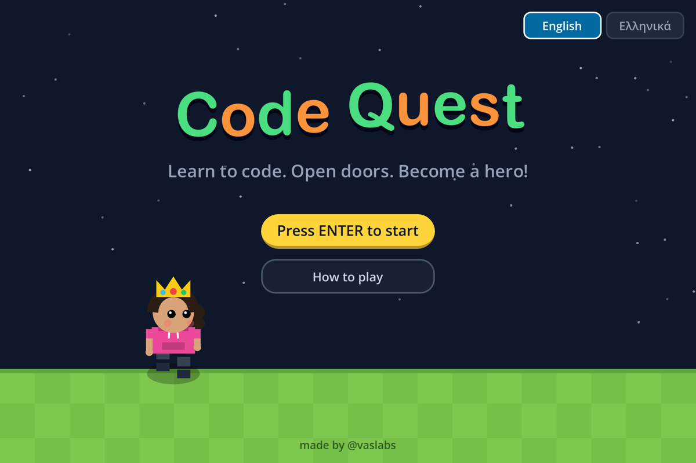

## Features

- **100 exercises in 10 levels,** from `print()` to functions, written for beginners.
- **A quiz at the end of every level:** 5 questions, mixing click-an-answer and typed answers. Kids need 4 out of 5 to pass, and missed answers are explained before they try again.
- **Code Lab:** kids write whole programs, press **Run** and see the output, with `input()` and friendly error messages. It includes 10 challenges that the game checks automatically.
- **Code Notebook:** every lesson a child solves is saved as a note card they can look back at.
- **Hero creator:** a name, skin colour, **10 hairstyles** (short, long, ponytail, pigtails, bun, curly, braids, spiky, bob, buzz cut) and **10 outfits** (T-shirt, dress, hoodie, dungarees, sports top, skirt, jacket, stripes, superhero, lab coat) in any colour. Anyone can pick any style. Extras such as a cap, sunglasses, headphones, a crown or a wizard hat are unlocked with icons.
- **Every child can make a hero like them:** the free **About me** tab offers a wheelchair, crutches, leg braces, a prosthetic leg or arm, glasses, an eye patch, hearing aids, a cochlear implant, ear defenders, an insulin pump and a service dog.
- **`</>` code icons** to collect on the maps, spent on hints and hero extras.
- **Several players** on one computer, each with their own hero and progress.
- **A progress report for parents and teachers** showing which topics needed extra help.
- **English / Ελληνικά,** switchable at any time.
- **Read aloud (switched off for now):** lessons, questions, quizzes and help can be read out loud in English or Greek, using the computer's built-in voices.
- **Break reminder:** after 30 minutes the game suggests a 5-minute break with stretching tips.
- **Everything is drawn in code,** so there are no image files.

## Screenshots

| | |
|---|---|
| 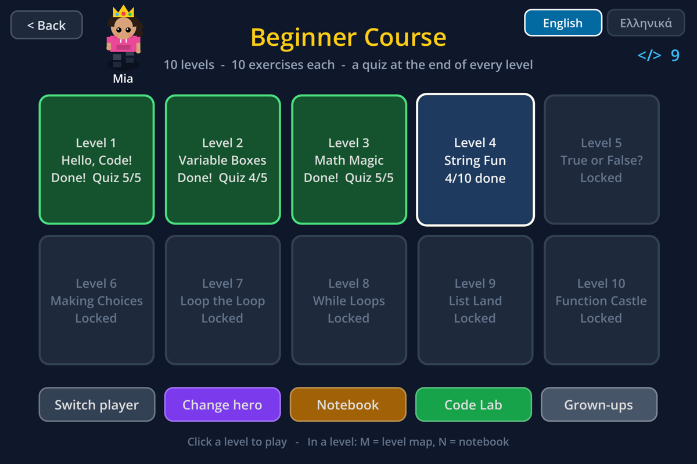 | 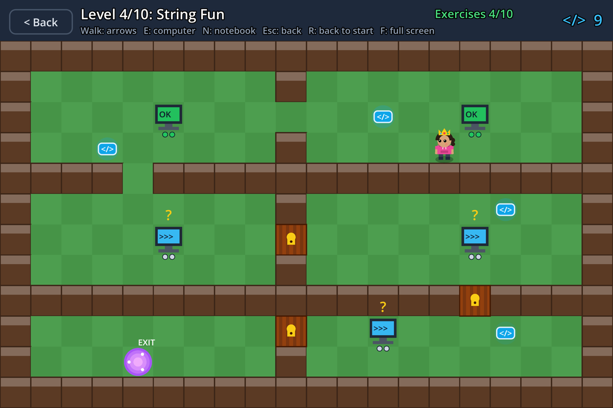 |
| **Level map:** 10 levels; each one unlocks when the previous quiz is passed | **A level:** walk to the computers and open the doors |
| 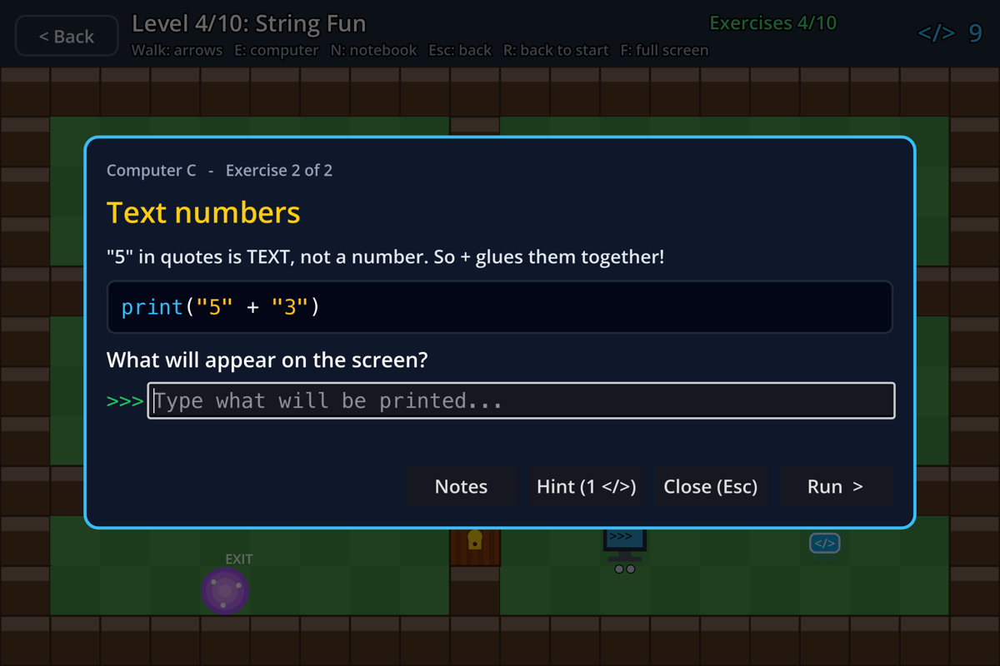 | 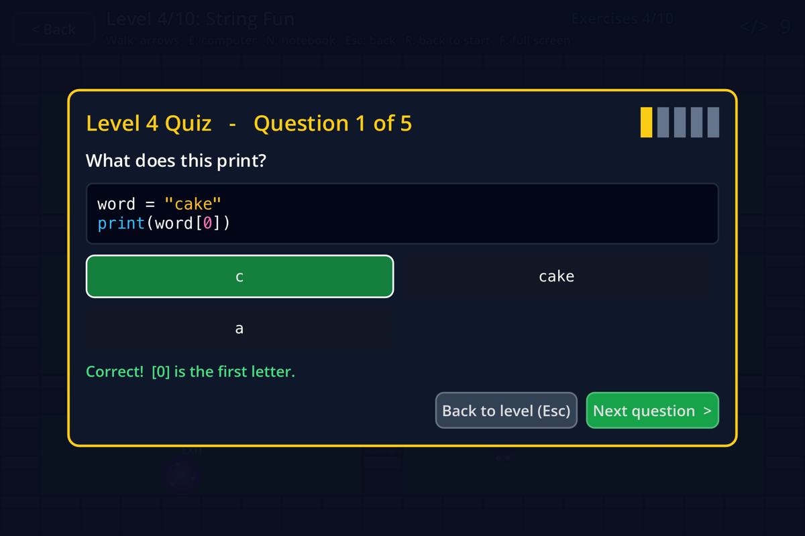 |
| **Exercise:** a short lesson, code to read, and a question | **Quiz** at the end of every level |
| 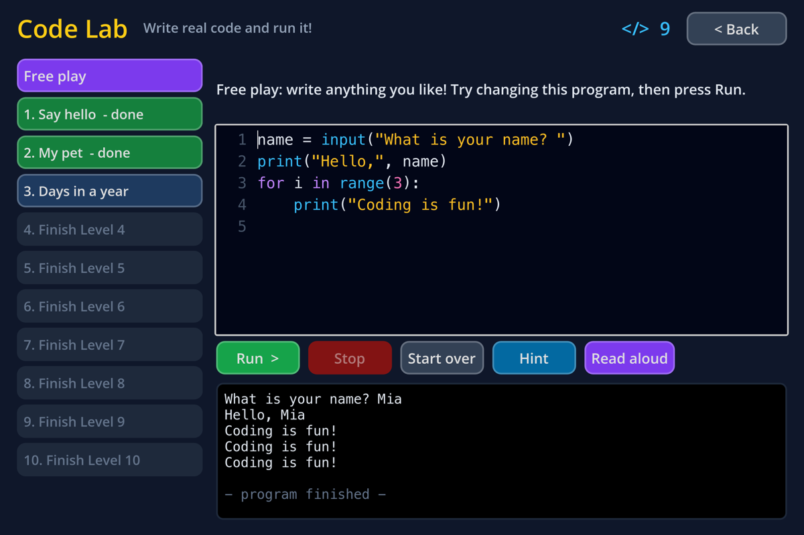 | 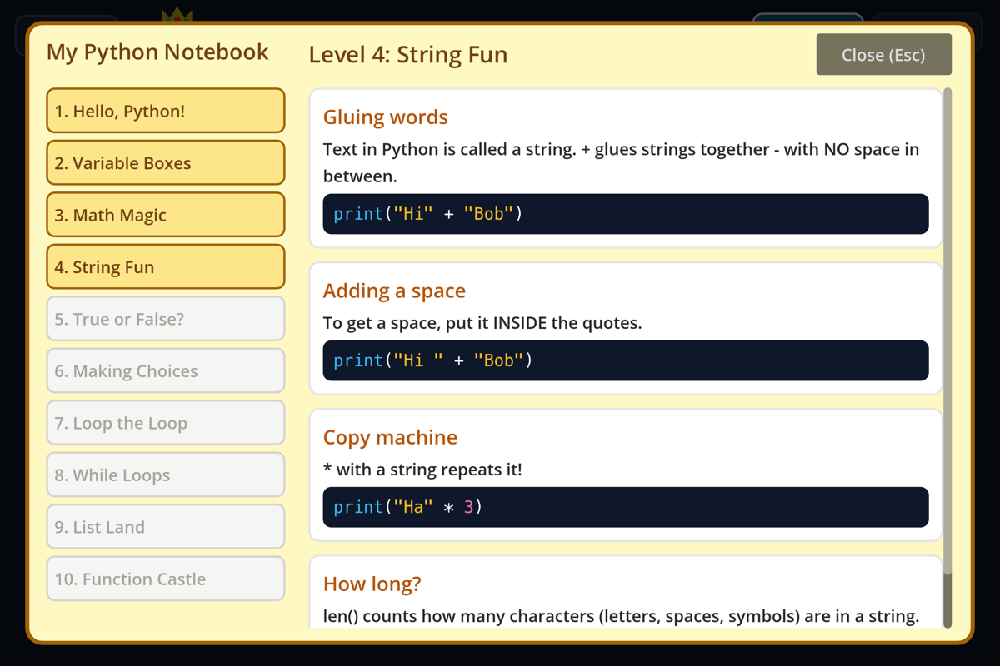 |
| **Code Lab:** write and run real programs | **Notebook:** everything learned so far |
| 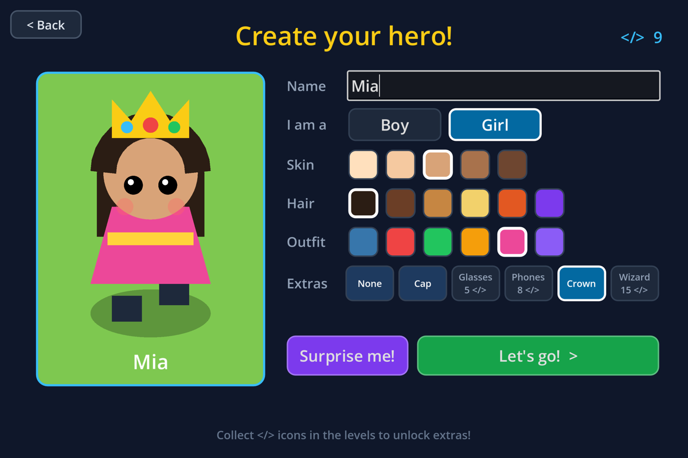 | 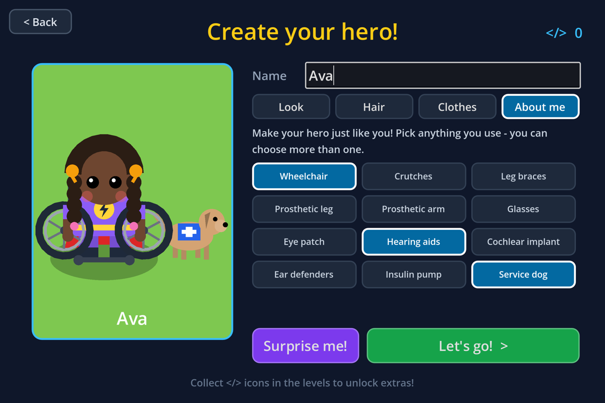 |
| **Create your hero:** 10 hairstyles, 10 outfits | **About me:** a hero just like you |
| 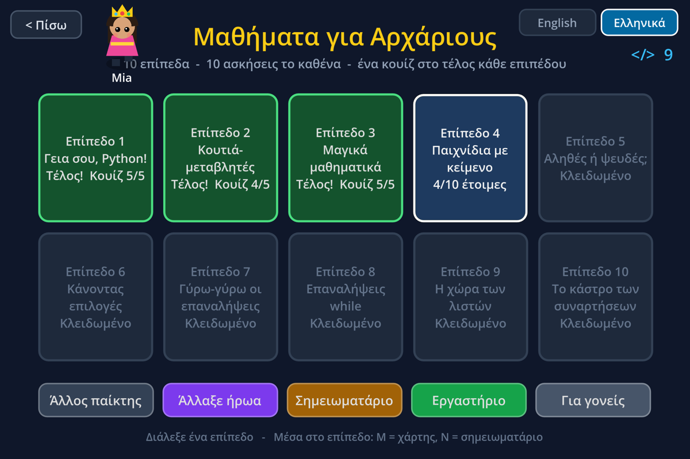 | |
| **Ελληνικά:** the whole game in Greek | |
| 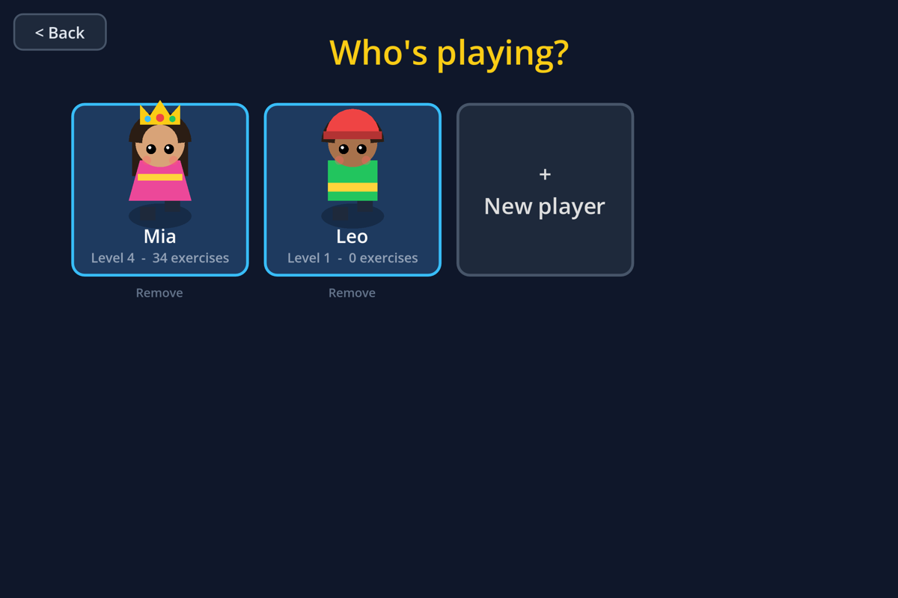 | 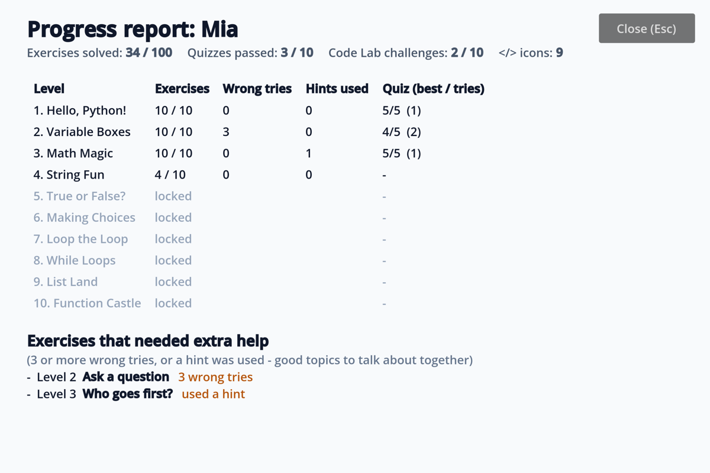 |
| **Who's playing?** Several kids on one computer | **Progress report** for grown-ups |

## How to run it

1. **Install Godot 4.3 or newer** from [godotengine.org/download](https://godotengine.org/download). Choose the standard version, not .NET.
2. **Download this project:** click **Code → Download ZIP** and unzip it, or run:
   ```
   git clone <this repository's URL>
   ```
3. **Open Godot,** click **Import**, and select the `project.godot` file in this folder.
4. **Press F5** (or the ▶ button) to play.

> **The game looks small inside the Godot editor?** In the editor's **Game** tab, open the **⋮** menu and untick **Embed Game on Next Play**. The game then opens in its own full-size window. Press **F** for full screen.

## How to play

| Key | What it does |
|---|---|
| Arrow keys / WASD | Walk |
| **E** | Use a computer and solve its coding exercises |
| **Enter** | Check your answer |
| **Esc** | Go back / close a window |
| **N** | Open your notebook |
| **M** | Go to the level map |
| **R** | Go back to the start of the level |
| **F** | Full screen |

- **Every map has 5 computers with 2 exercises each.** Solving both opens that computer's door.
- **Walk into the purple EXIT portal** to take the level's quiz.
- **Collect the `</>` icons.** A hint costs 1 icon, but after 2 wrong tries the hint is free. Icons also unlock hero extras.

## The Beginner course

| Level | Topics |
|---|---|
| 1. Hello, Code! | `print()`, `#` comments, reading error messages |
| 2. Variable Boxes | variables, `=`, `input()`, NameError |
| 3. Math Magic | `+ - * / // %`, order of operations |
| 4. String Fun | joining text, `len()`, `.upper()`, indexes, `int()` and `str()` |
| 5. True or False? | comparisons, `and`, `or` |
| 6. Making Choices | `if` / `elif` / `else`, indentation |
| 7. Loop the Loop | `for` loops and `range()` |
| 8. While Loops | `while` loops and `+=` |
| 9. List Land | lists, `.append()`, `[-1]`, `in` |
| 10. Function Castle | `def`, `return`, calling functions |

The code itself stays in English in both languages, because programming languages are written in English everywhere. Everything around the code is translated.

## For parents and teachers

- **Inclusive heroes:** in **Create your hero → About me**, children can give their hero what they use in real life. There are 12 options, any combination works, and they're always free rather than unlocked with icons.

  | Group | Options |
  |---|---|
  | Moving | wheelchair, crutches, leg braces, prosthetic leg, prosthetic arm |
  | Seeing | glasses, eye patch |
  | Hearing | hearing aids, cochlear implant |
  | Sensory | ear defenders |
  | Medical | insulin pump |
  | Helper | service dog |

  To add or change options, see the `AIDS` list in [`scripts/hero_sprite.gd`](scripts/hero_sprite.gd).

- **Read aloud (switched off for now):** to turn it on, set `READ_ALOUD_ON` to `true` at the top of [`scripts/speech.gd`](scripts/speech.gd). A **Read aloud** button then reads the lesson and question for younger readers. It uses the computer's own voices; on a Mac these are *Samantha* for English and *Melina* for Greek. If a voice isn't installed, the button is hidden.
- **Break reminder:** after **30 minutes** the game pauses and suggests a **5-minute break**. Kids can take the break, which shows a countdown with tips such as stretching or drinking water, or keep playing and get reminded again in 15 minutes. To change the times, edit the three numbers at the top of [`scripts/break_reminder.gd`](scripts/break_reminder.gd).

- **Progress report:** **Grown-ups** on the level map shows, for each level:
  - exercises solved
  - wrong tries
  - hints used
  - quiz scores

  It also lists the exercises a child found hard.
- **Players:** up to 8 children can each have their own profile. Progress is saved automatically, including partway through a level.
- **Language:** switch between English and Ελληνικά on the title screen or the level map.

## Changing or adding content

All the course content is plain text in GDScript files, so you don't need to change any game code.

### Exercises and quizzes

Each level is one file in [`scripts/courses/beginner/`](scripts/courses/beginner/). An exercise looks like this:

```gdscript
{
    "title": "Who goes first?",
    "lesson": "The computer does * BEFORE +.",
    "code": "print(3 + 4 * 2)",
    "question": "What will appear on the screen?",
    "mode": "output",            # "output" = type what's printed, "code" = write code
    "answers": ["11"],           # any of these is accepted
    "hint": "Do 4 * 2 first.",
    "mistakes": {"14": "The computer multiplies first!"},   # optional tips for common wrong answers
    "case_sensitive": true,      # optional: capitals must match
    "error": "NameError: ...",   # optional: shows a red error box
    "el": {"title": "...", "lesson": "...", "question": "...", "hint": "..."},  # Greek
},
```

How answers are checked:
- In `output` mode, extra spaces don't matter, and capitals don't either unless `case_sensitive` is set.
- In `code` mode, spaces are ignored and `'` and `"` count as the same.

Quiz questions:

```gdscript
{"type": "choice", "question": "...", "code": "...", "options": ["right", "wrong", "wrong"], "answer": 0, "explain": "..."}
{"type": "output", "question": "...", "code": "...", "answers": ["..."], "explain": "..."}
{"type": "code",   "question": "...", "answers": ["..."], "explain": "..."}
```

Answer buttons are shuffled in the game, so you can always list the right answer first.

### Other content

| What | Where |
|---|---|
| Code Lab challenges | [`scripts/lab_challenges.gd`](scripts/lab_challenges.gd) |
| Greek buttons and menus | [`scripts/i18n/greek_ui.gd`](scripts/i18n/greek_ui.gd) |
| Maps | [`scripts/maps.gd`](scripts/maps.gd). Each level picks a map and can flip it with `"variant"` (0 to 3). |
| A new course, e.g. Intermediate | make a folder of level files and list them in [`scripts/courses.gd`](scripts/courses.gd) |

## How it's built

- **Godot 4, GDScript only.** Every character, door and computer is drawn with code, so there are no image or sound files to manage.
- **A small code runner inside the game** ([`scripts/code_runner.gd`](scripts/code_runner.gd)) powers the Code Lab. It covers the whole Beginner course and gives real-style error messages. It was checked against the real language on 181 programs and gave identical results.
- **Every exercise and quiz answer was checked** by running its code in the real programming language.

| File | What it does |
|---|---|
| `scripts/main.gd` | screen flow and level building |
| `scripts/puzzle_panel.gd` | exercise window |
| `scripts/quiz_panel.gd` | end-of-level quiz |
| `scripts/code_lab.gd`, `scripts/code_runner.gd` | Code Lab and its built-in code runner |
| `scripts/level_select.gd` | level map |
| `scripts/title_screen.gd` | title screen |
| `scripts/help_panel.gd` | "How to play" menu |
| `scripts/character_creator.gd` | hero creator |
| `scripts/profile_select.gd` | "Who's playing?" screen |
| `scripts/notebook.gd` | Code Notebook |
| `scripts/report.gd` | progress report |
| `scripts/save_data.gd`, `scripts/profiles.gd` | saved progress for each player |
| `scripts/lang.gd`, `scripts/i18n/` | English / Greek |
| `scripts/speech.gd` | read aloud |
| `scripts/break_reminder.gd` | break reminder |
| `scripts/hero_sprite.gd`, `player.gd`, `terminal.gd`, `door.gd`, `code_icon.gd`, `exit_portal.gd`, `level_drawer.gd` | the drawn game objects |

---

Made by **@vaslabs**
